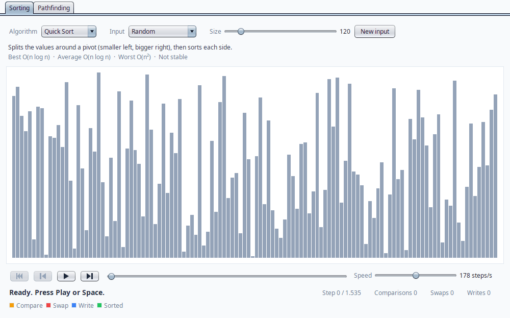
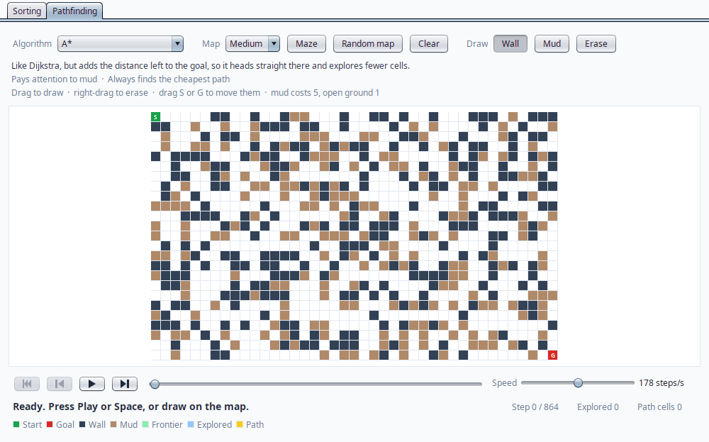
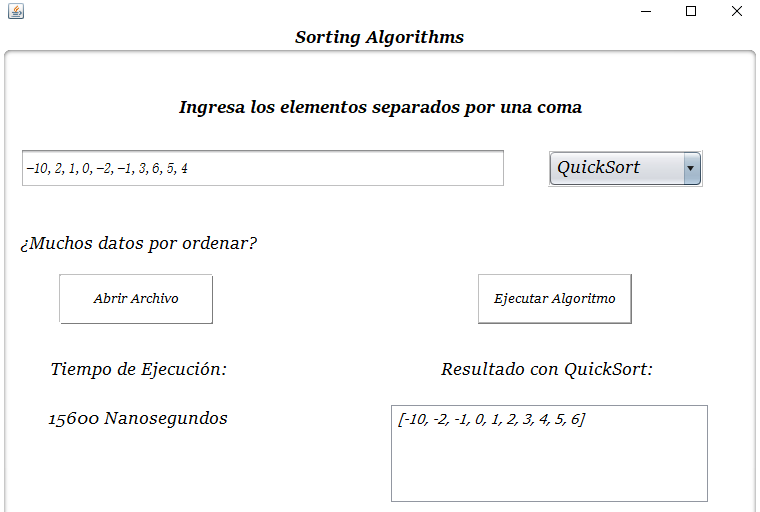

# AlgoScope · Sorting Algorithms

[](https://github.com/Josafath/Sorting-Algorithms/actions/workflows/v2-tests.yml)
[](https://github.com/Josafath/Sorting-Algorithms/actions/workflows/v1-tests.yml)
%20%7C%208%20(v1)-orange)


A Java desktop app that **animates algorithms step by step**: six sorting algorithms on bars, and BFS, DFS, Dijkstra and A* finding their way through a maze. Every step is recorded, so the animation can be played forwards and backwards, paused, or jumped to any point, with live counters of what the algorithm is doing.





## Why this project

To understand an algorithm I need to build something with it. I had been using Python for a long time and this started as my way to practice Java. The project exists in two versions, written years apart, and both are kept so the difference is visible:

| | [v1](v1/) (original) | [v2](v2/) AlgoScope |
|---|---|---|
| **What it does** | Sorts the numbers you type and shows the time | **Animates** each algorithm step by step, forwards and backwards |
| **Algorithms** | 5 sorting | **6 sorting + 4 pathfinding** (BFS, DFS, Dijkstra, A*) + a maze generator |
| **What it measures** | One time in nanoseconds (JIT noise included) | **Comparisons, swaps and writes**; cells explored, path steps and cost |
| **Inputs** | Typed numbers or a `.txt` file | Random, sorted, reversed or few-unique arrays; mazes, random maps or your own drawing |
| **Interface** | NetBeans GUI Builder, Spanish, Windows-only fonts | Hand-written Swing, English, the same on every system |
| **Java** | 8 | **21**: records, sealed interfaces, pattern matching `switch` |
| **Dependencies** | None | None, not even for tests |
| **Tests** | 94 (added when fixing it) | **344**, including the UI without a screen |

📐 **[How v2 is built](v2/docs/ARCHITECTURE.md)**: record once and replay, the packages, the playback clock, the limits, and how it is tested.

📚 **[The algorithms](v2/docs/ALGORITHMS.md)**: how each one works, with real numbers from the app, and why one small tie-break makes A* explore 59 cells instead of 900.

---

## v2: AlgoScope

### Sorting

Bubble, Insertion, Selection, Merge, Quick and Heap Sort, on **random, already sorted, reversed or few-unique** inputs of 5 to 1,000 values. Bars turn **amber** when compared, **red** when swapped, **blue** when written, and **green** when everything is sorted. Below the bars, the current step in words ("Comparing #3 (48) and #4 (16)") and the counters.

Changing the algorithm keeps the same input, so they can be compared on exactly the same data: on 100 random values Bubble Sort makes 4,935 comparisons and Merge Sort 596.

### Pathfinding

BFS, DFS, Dijkstra and A* on a grid with **walls** and **mud** (entering mud costs 5, open ground 1). The frontier is **green**, explored cells **blue**, and the path **yellow**.

- **Draw** walls or mud by dragging the mouse; right-drag erases; drag the **S** or the **G** to move the start or the goal.
- **Generate** a maze (carved with DFS, with a few loops) or a random map, in three sizes.

Mud is what makes the algorithms differ. On the map of the animation above, BFS finds the path with the fewest steps (64) but it costs 140 because it walks straight through the mud; A* goes around it in 70 steps for a cost of 78, exploring half as many cells.

### Controls

| Action | Key |
|---|---|
| Play / pause | Space |
| One step forward / back | Right / Left |
| Back to the start | Home |
| Jump anywhere | Drag the progress bar |
| Speed, from 1 to ~30,000 steps per second | Speed slider |

### Requirements

**JDK 21 or newer.**
- **Windows:** install [Eclipse Temurin 21](https://adoptium.net/) and check *Set JAVA_HOME* and *Add to PATH* in the installer.
- **macOS:** install Temurin 21 from the same page, or with Homebrew: `brew install --cask temurin@21`.
- **Linux:** your distribution's OpenJDK 21 (for example `sudo apt install openjdk-21-jdk`).

Check it with `java -version` and `javac -version`.

### Run it

Inside the `v2` folder:

| | Windows | macOS / Linux |
|---|---|---|
| Open the app | `run.bat` | `./run.sh` |
| Run the tests | `test.bat` | `./test.sh` |

The scripts compile into `v2/out` and need nothing else. The tests run without opening any window, also on GitHub Actions for Windows, macOS and Linux.

### Project structure

```
v2/
├── src/algoscope/
│   ├── engine/         Step and Timeline: record once, replay forwards and backwards
│   ├── sorting/        The six sorting algorithms and the array that records them
│   ├── pathfinding/    Grid, BFS, DFS, Dijkstra, A*, maze and random map generators
│   └── ui/             The window, the shared player and playback bar
│       ├── sorting/        Sorting tab
│       └── pathfinding/    Pathfinding tab
├── test/algoscope/     344 tests with a small runner of our own (Check, AllTests)
├── docs/               ARCHITECTURE.md, ALGORITHMS.md and the animations
├── run.sh / run.bat    Compile and open the app
└── test.sh / test.bat  Compile and run the tests
```

---

## v1

The original project, with its bugs fixed and nothing redesigned. The interface is in Spanish, as it was built.



📐 **[How the five v1 algorithms work](v1/docs/ALGORITHMS.md)**

### How to use it

- **Few numbers:** type them in the text field, separated by commas or spaces (`5, 3, 8, -1`), choose the algorithm and press **Ejecutar Algoritmo**. The sorted numbers appear on the right.
- **Many numbers:** press **Abrir Archivo** and choose a `.txt` file. The numbers can be on one line or on many lines, separated by commas, spaces or new lines. When the sort finishes, the app asks where to save the result, one number per line.

Sorting runs in the background, so the window does not freeze with big files.

### What was fixed

| Problem | Before | Now |
|---|---|---|
| Merge Sort from a file | Called with the wrong indexes: the file came out unsorted | Sorted, same code as the text field |
| QuickSort and Merge Sort from a file | The last number was missing from the saved file | Every number is saved |
| Reading a file | Only the last line was read | Every line is read |
| Cancel in the file dialog | `NullPointerException` | Nothing happens |
| Saving the result | Always `C:\Users\<user>\Desktop`, which fails on macOS and Linux, and appended to the old file | You choose where; the file is replaced, asking first if it exists |
| `3, 4` (with a space), letters, empty field | Crashed without telling the user | Clear error message with the wrong value |
| Bubble Sort and Insertion Sort | The array was `static`: two objects shared the same array | Each object has its own array |
| "Bubble Sort" | Was actually exchange sort | Real bubble sort, stops early when already sorted |
| QuickSort with already sorted data | `StackOverflowError` around 50,000 numbers | Middle pivot and bounded recursion: tested with 200,000 |
| Compiled files and personal NetBeans settings | Committed to the repository | Ignored with `.gitignore` |

### Requirements

- **JDK 8 or newer** (the project targets Java 8; tested with 8 and 21).
  - **Windows:** install [Eclipse Temurin](https://adoptium.net/) and check *Set JAVA_HOME* and *Add to PATH* in the installer.
  - **macOS:** install Temurin from the same page, or with Homebrew: `brew install --cask temurin`.
  - Check it with `java -version` and `javac -version`.
- **NetBeans** is optional: you can also run everything from a terminal.

### Run it

**With NetBeans:** *File → Open Project*, choose the `v1` folder and press *Run* (F6).

**From a terminal**, inside the `v1` folder:

Windows (Command Prompt or PowerShell):

```bat
mkdir out
javac -encoding UTF-8 -d out src\Algorithms\*.java src\Menu\*.java
java -cp out Menu.Principal
```

macOS and Linux:

```bash
mkdir -p out
javac -encoding UTF-8 -d out src/Algorithms/*.java src/Menu/*.java
java -cp out Menu.Principal
```

(`mkdir` is needed with Java 8, whose `javac` does not create the `out` folder; on Windows it only warns if the folder already exists.)

### Tests

94 checks with no external library, only the JDK: every algorithm against `Arrays.sort` (empty arrays, one element, repeated and negative values, `Integer.MIN_VALUE`/`MAX_VALUE`, random arrays), QuickSort with 200,000 sorted, reversed and equal numbers, and the reading and writing of numbers. They run on Windows, macOS and Linux with Java 8 and 21 on every pull request.

Inside the `v1` folder:

```bash
mkdir -p out
javac -encoding UTF-8 -d out src/Algorithms/*.java src/Menu/*.java test/tests/*.java
java -Djava.awt.headless=true -cp out tests.SortingTests
```

(On Windows use `\` instead of `/` in the paths.) In NetBeans: open `Test Packages → tests → SortingTests.java` and choose *Run File* (Shift+F6).

### Project structure

```
v1/
├── src/
│   ├── Algorithms/          The five algorithms, one class each
│   └── Menu/
│       ├── Principal.java   The window (built with the NetBeans GUI Builder) and the sort dispatcher
│       ├── Principal.form   NetBeans layout of the window
│       └── NumberIO.java    Reads, validates and writes the numbers
├── test/tests/SortingTests.java
├── docs/                    ALGORITHMS.md and the screenshot
├── nbproject/, build.xml    NetBeans / Ant project
└── manifest.mf
```
