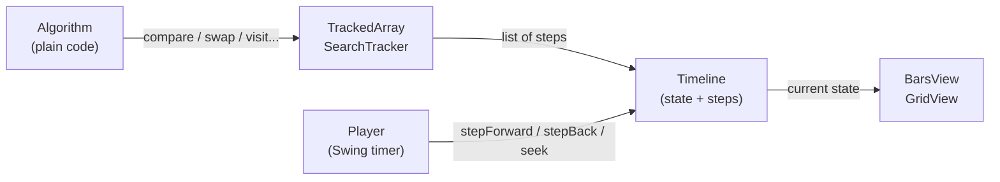

# AlgoScope architecture

How v2 is put together, why, and how it is tested. For what each algorithm does, see [ALGORITHMS.md](ALGORITHMS.md).

## The idea: record once, replay anywhere

Most algorithm visualizers put the animation inside the algorithm: draw, `Thread.sleep()`, continue. That mixes two jobs, needs a thread per run, and makes "one step back" impossible.

AlgoScope separates them:



1. **Record.** The algorithm runs once, to the end, without knowing it is being watched. It only touches the data through a *tracker* (`TrackedArray` for sorting, `SearchTracker` for pathfinding), which counts every operation and stores it as a **step**.
2. **Replay.** A `Timeline` holds the state (the array or the grid) and the list of steps. Every step can be **applied** and **undone**, so the timeline can move forwards, backwards, or jump to any position.
3. **Show.** A `Player` advances the timeline on a Swing timer, and the views paint whatever state the timeline is at.

Consequences:

- **Step back is free:** it is just `undo()` on the last step.
- **The algorithms stay readable:** `BubbleSort` is the textbook loop, with `a.compare(j, j + 1)` instead of `a[j] > a[j + 1]`. No threads, no sleeps, no UI code.
- **Everything is deterministic and testable without a screen:** a recording is a list of values.
- **Replay counters are exact:** the counters on screen are updated by the steps themselves, so after rewinding they go back to zero.

## Packages

```
algoscope
├── engine        Step, Timeline                      generic, knows nothing about sorting or grids
├── sorting       6 algorithms, TrackedArray, SortStep, SortState, SortRecorder, InputKind
├── pathfinding   Grid, 4 algorithms, SearchTracker, SearchStep, SearchState, SearchRun, GridGenerator
└── ui            MainWindow, Player, PlaybackBar, Speed, StepClock, Theme, Widgets, ShapeIcon
    ├── sorting       SortingSession, BarsView, SortingPanel
    └── pathfinding   PathfindingSession, GridView, PathfindingPanel
```

Dependencies only go downwards: `ui` uses `sorting` and `pathfinding`, which use `engine`. Nothing below `ui` imports Swing.

## Steps are sealed records

```java
public sealed interface SortStep extends Step<SortState> {
    record Compare(int i, int j) implements SortStep { ... }
    record Swap(int i, int j) implements SortStep { ... }
    record Write(int index, int oldValue, int newValue) implements SortStep { ... }
}
```

- **`sealed`:** these are the only possible steps, so a `switch` over them is checked by the compiler. The bar colors and the description under the animation are both exhaustive switches with no `default`: adding a fourth step kind would not compile until both handle it.
- **Records:** immutable, with `equals` for free (useful in tests).
- **Undo information lives in the step:** `Write` keeps the old value, and each `SearchStep` keeps the cell's status before the change.

Pathfinding has the same shape: `Discover` (the cell joins the frontier), `Visit` (it is explored) and `PathCell` (it is part of the route).

## Playback

- **`Player`** works with any `Timeline`, so both tabs share it. A `javax.swing.Timer` ticks about 60 times per second, always on the Swing thread, and stops when the recording ends, so an idle app does no work.
- **`StepClock`** turns elapsed time into a whole number of steps. The leftover fraction is carried to the next frame: at 10 steps per second each frame is worth 1/6 of a step, and without the carry the animation would never move. One frame counts for 250 ms at most, so after the computer sleeps the animation does not jump to the end.
- **`Speed`** is logarithmic: from 1 to about 31,600 steps per second on the same slider, enough to follow one comparison or to finish 1,000 bars in a few seconds.
- **`PlaybackBar`** holds the buttons, the progress bar, the speed and the keyboard shortcuts. Swing only delivers key bindings to components that are showing, so Space only controls the tab on screen. Switching tabs pauses both.

## The UI layer

Each tab has three parts:

| Part | Sorting | Pathfinding | Role |
|---|---|---|---|
| Session | `SortingSession` | `PathfindingSession` | What the user chose and the resulting recording. No Swing code, so it is tested directly. |
| View | `BarsView` | `GridView` | Paints the timeline's current state. The color rules are static methods, tested without painting. |
| Panel | `SortingPanel` | `PathfindingPanel` | Builds the controls, reacts to them, and refreshes labels after every player change. |

Other decisions:

- **Swing written by hand.** v1 used the NetBeans GUI Builder, whose generated code can only be edited in NetBeans. v2 builds the layout in code that reads in any editor.
- **Nimbus look and feel**, which looks the same on Windows, macOS and Linux, and Java's logical fonts (Dialog, SansSerif). v1 used Sitka Text and SimSun, which only exist on Windows.
- **Icons are drawn with shapes** (`ShapeIcon`): symbols like ▶ are missing from some fonts.
- **No external libraries.** Only the JDK, for the app and for the tests.

## Limits, on purpose

- **Recordings of up to 1,000 values** (`SortRecorder.MAX_LENGTH`). Bubble Sort on 1,000 reversed values is about 750,000 steps; much more would use a lot of memory and nobody can follow it anyway. `TrackedArray` can also sort without recording, counting with `long`s, for any size.
- **Maps of up to 41 x 71 cells.** Every edit (each painted cell) records the whole search again. At this size it takes a few milliseconds, so the simple approach is fast enough.
- **Moves in four directions**, no diagonals.
- **A\*'s estimate assumes the cheapest terrain costs 1.** If cheaper terrain were added, the estimate would have to change or A* could miss the cheapest path (see ALGORITHMS.md).
- **No timing benchmark.** Measuring time reliably in Java needs JIT warm-up and many runs; the comparison, swap and write counters show the same O(n²) vs O(n log n) story without that noise.

## Testing

344 tests, run by `test.sh` / `test.bat` and by GitHub Actions on Windows, macOS and Linux.

**A tiny runner instead of JUnit.** `Check` prints PASS/FAIL and `AllTests` exits with code 1 on any failure. `Check.group` catches exceptions, so a crash counts as one FAIL and the other groups still run. The project needs only the JDK, even for tests.

**What is checked:**

| Area | How |
|---|---|
| Sorting | Every algorithm against `Arrays.sort`: empty, single, duplicates, negatives, `Integer.MIN_VALUE`/`MAX_VALUE`, all input kinds from 1 to 5,000 values, and Quick Sort on 1,000,000 sorted, reversed and equal values. |
| Counters | Against the theory: Bubble Sort stops after n-1 comparisons on sorted input, Selection Sort always compares every pair, Merge Sort skips merges that are already in order, n·log n bounds for the fast ones. |
| Pathfinding | Against an independent **reference solver** (Bellman-Ford: relax every cell until nothing changes; slow but too simple to get wrong) on 300 random maps, 139 of them without a route. |
| Replay | Playing to the end gives the algorithm's result; rewinding gives back the input and zero counters; every step points inside the data. |
| Playback | `StepClock` and `Player` with time passed by hand, so no test depends on the real clock. |
| UI | Headless: bar and cell colors checked pixel by pixel in an image, pixel-to-cell conversion, buttons pressed with `doClick`, and mouse drags sent as `MouseEvent`s (a continuous wall even when the mouse jumps cells). |

**Testing the tests.** After each phase, bugs were planted on purpose in a copy of the code (a wrong comparison, a missing undo, an overestimating heuristic, a reversed path, no tie-break in A*...) to check that some test fails. Two gaps found that way became new tests: Merge Sort on all-equal values, and the direction DFS explores first.

## Adding an algorithm

**Sorting:** create a class that implements `SortAlgorithm`, sort only through the `TrackedArray` methods, and add it to `SortAlgorithms.ALL`. It appears in the menu, and the existing tests already loop over `ALL`: it is checked against `Arrays.sort`, replayed, rewound and checked for valid step indexes without writing a new test.

**Pathfinding:** implement `PathfindingAlgorithm`, mark cells only through `SearchTracker` and call `foundPath` at the end, then add it to `PathfindingAlgorithms.ALL`. `foundPath` rejects a path that does not go from start to goal through open neighbours, so a broken algorithm fails loudly.
